# Mạch — Phần mềm quản lý tài chính cho doanh nghiệp Việt

**Mạch** là ứng dụng web quản lý tài chính dành cho doanh nghiệp vừa và nhỏ tại Việt Nam. Mạch **kết nối với các tài khoản ngân hàng công ty đang dùng** để doanh nghiệp quản lý mọi việc trong một nơi:

- Số dư và giao dịch từ mọi ngân hàng
- Lệnh chi có duyệt nhiều cấp, VietQR
- Quản lý thẻ doanh nghiệp do ngân hàng phát hành
- Ngân sách nhóm, hoàn ứng
- Thanh toán hoá đơn nhà cung cấp
- Xuất hoá đơn cho khách hàng
- Sổ sách kế toán theo Thông tư 200
- Trợ lý AI trả lời câu hỏi về dòng tiền

> ⚠️ Đây là **sản phẩm demo giao diện** do [Ntahien Tech](https://ntahientech.com) thiết kế và lập trình. Toàn bộ dữ liệu (công ty, người dùng, ngân hàng, số tài khoản, giao dịch) là **dữ liệu mô phỏng**. Mạch không phải ngân hàng hay tổ chức tín dụng, không giữ tiền và không xử lý giao dịch thật. Tên ngân hàng như "Thịnh An", "Lạc Hồng" là hư cấu.

🔗 **Demo:** https://mecury.vercel.app — bấm **"Dùng tài khoản demo"** ở trang đăng nhập (hoặc mở thẳng [/dang-nhap?demo=1](https://mecury.vercel.app/dang-nhap?demo=1)).

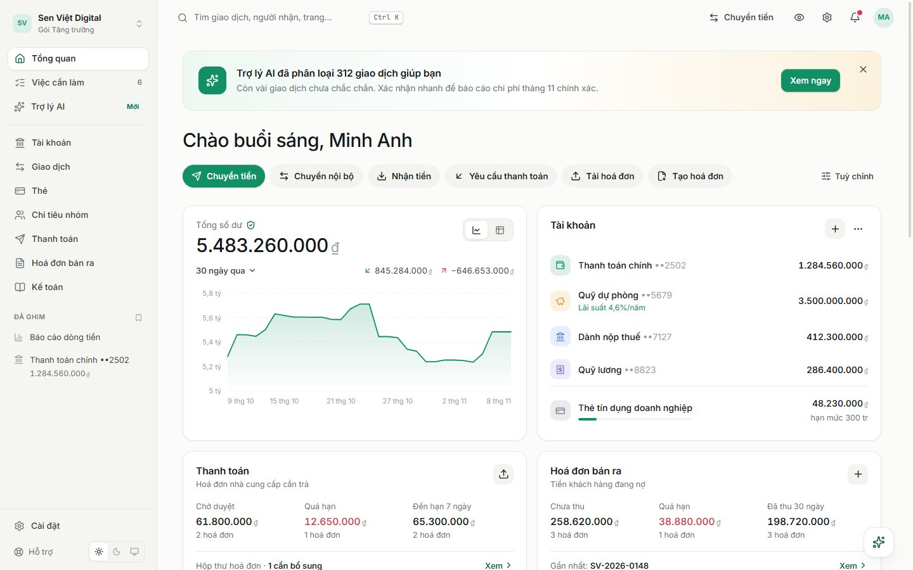

## Ảnh giao diện

| Trang giới thiệu | Thiết lập doanh nghiệp |
|---|---|
| 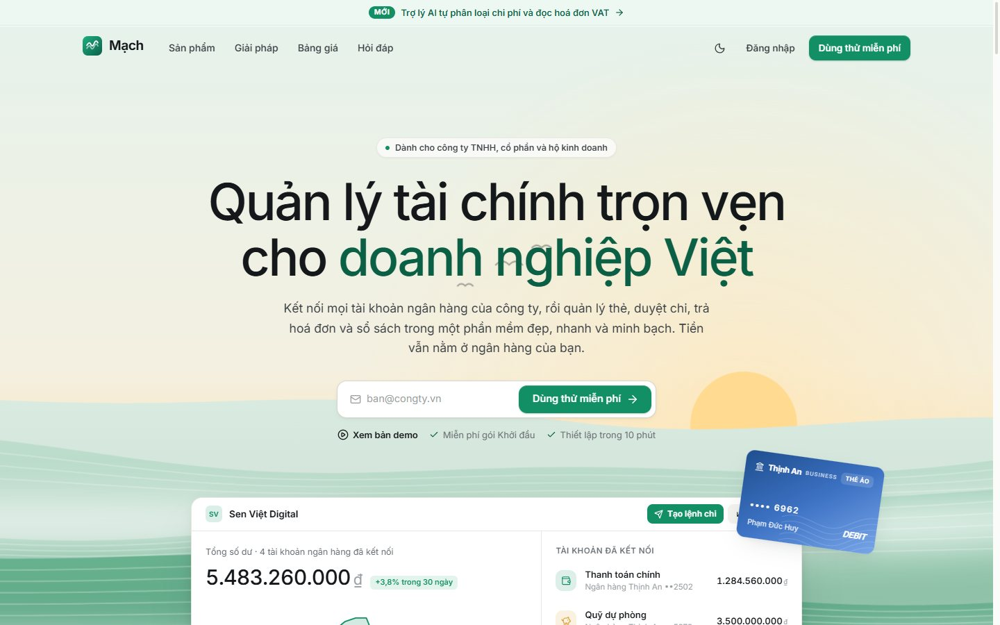 | 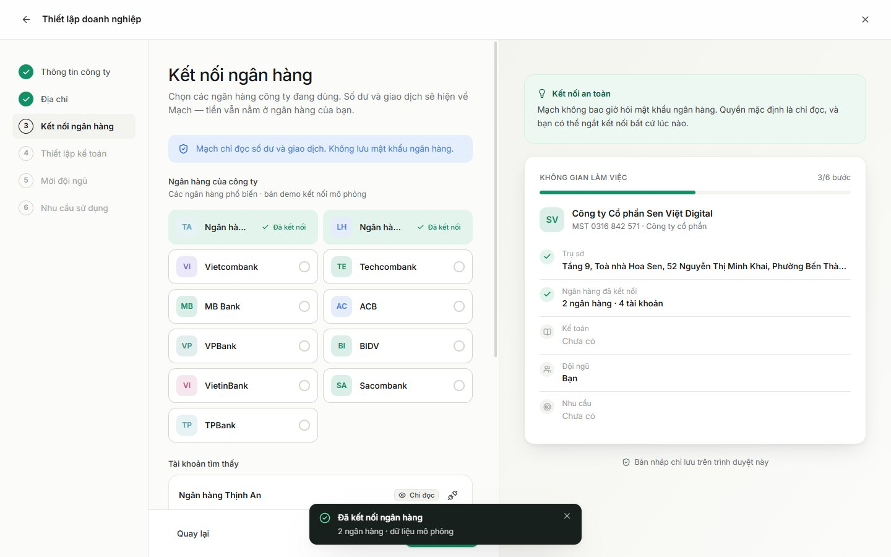 |
| **Giao dịch & ngăn chi tiết** | **Lệnh chi có xem trước uỷ nhiệm chi** |
| 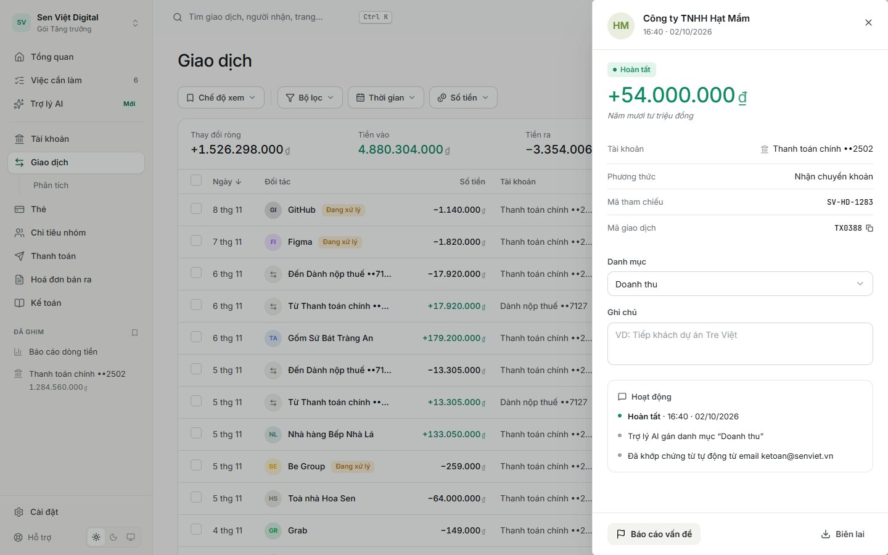 | 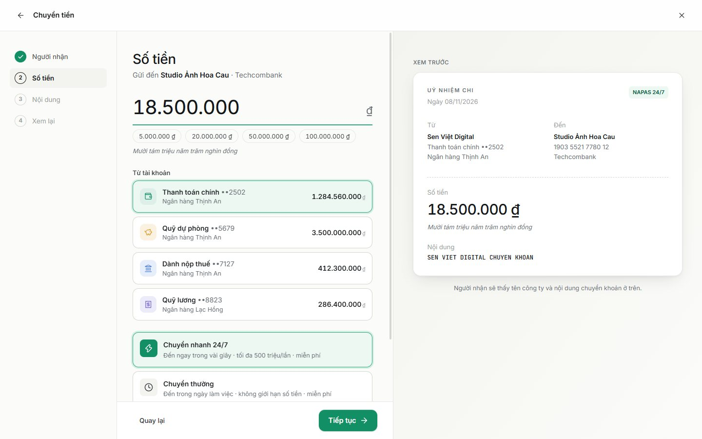 |
| **Phân tích dòng tiền** | **Quản lý thẻ doanh nghiệp** |
| 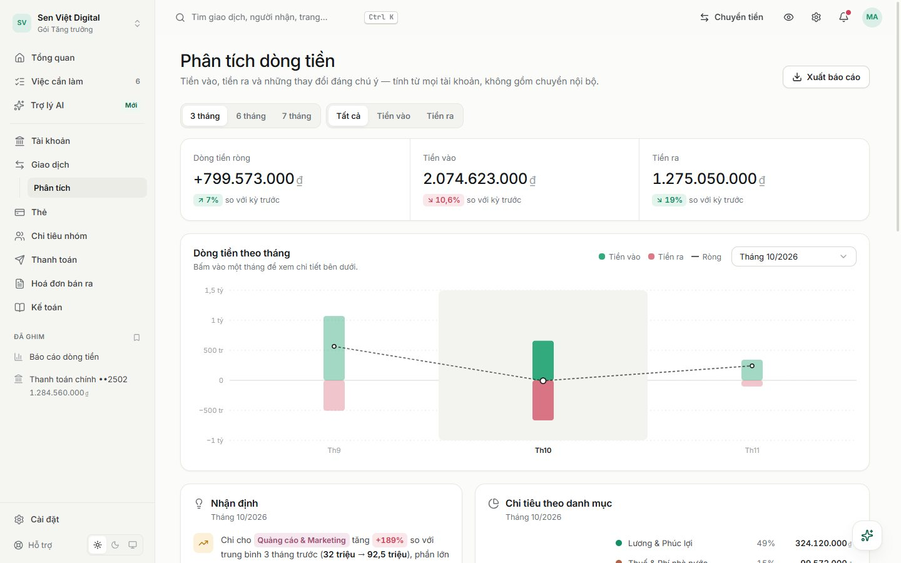 | 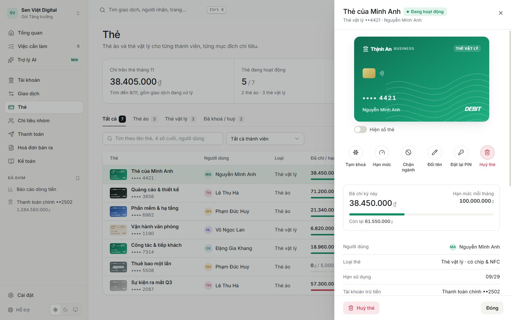 |
| **Duyệt & thanh toán hoá đơn** | **Tạo hoá đơn GTGT (xem trước trực tiếp)** |
| 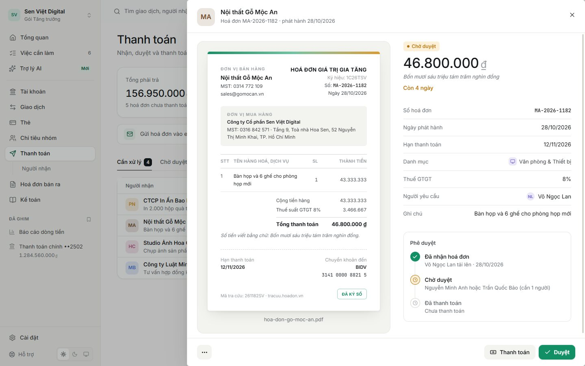 | 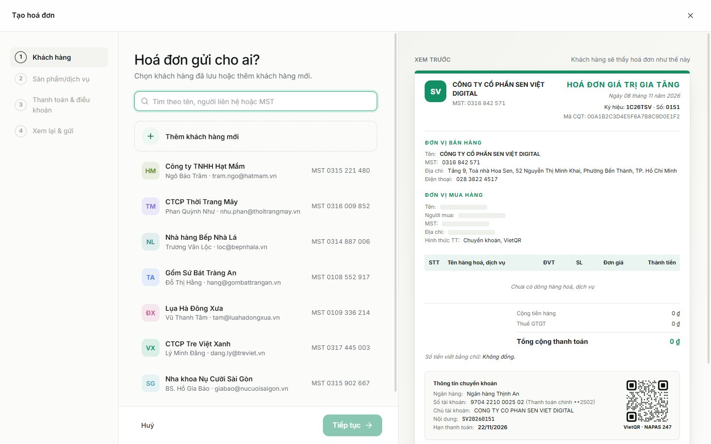 |
| **Kế toán (Thông tư 200)** | **Chi tiêu nhóm** |
| 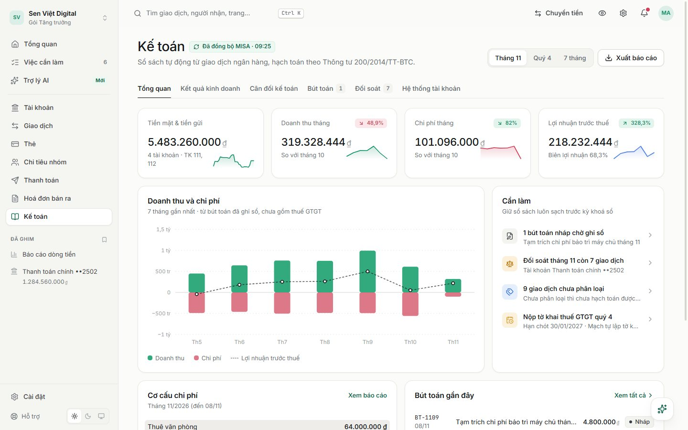 | 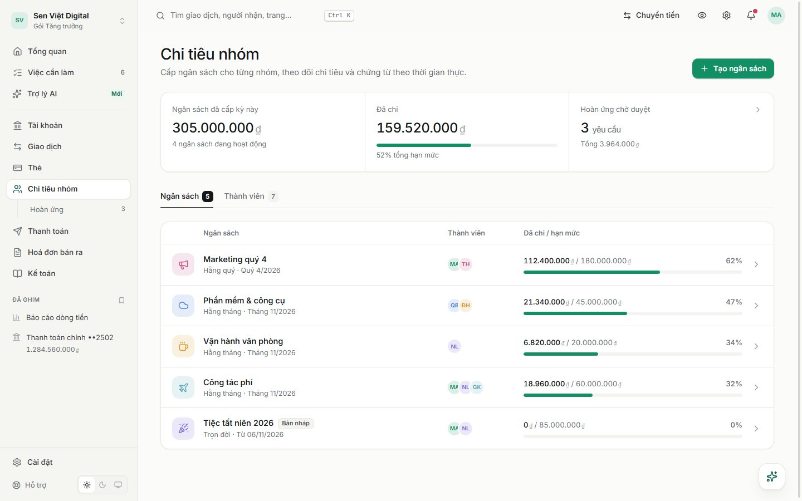 |
| **Trợ lý AI** | **Giao diện tối** |
| 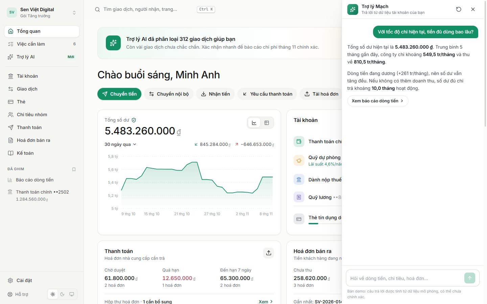 | 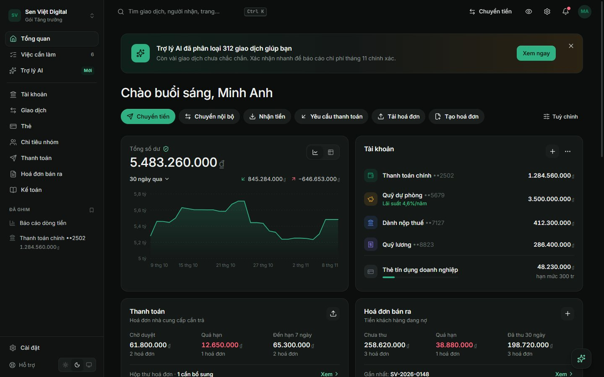 |

<p align="center">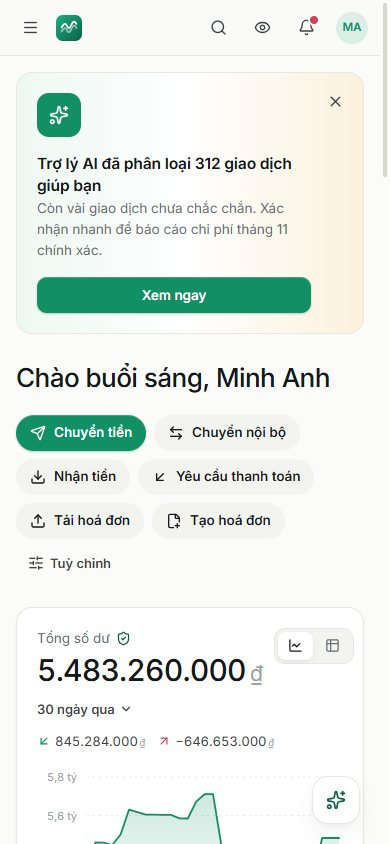</p>

## Chạy thử

```bash
cd frontend
npm install
npm run dev        # http://localhost:5190
```

Mở trang **Đăng nhập** rồi bấm **"Dùng tài khoản demo"**, hoặc vào thẳng `/dang-nhap?demo=1`.

Bản build tĩnh: `npm run build`, kết quả nằm trong `frontend/dist`. Khi triển khai lên Vercel, chọn **Root Directory = `frontend`**. Tệp `vercel.json` đã cấu hình điều hướng cho ứng dụng một trang.

## Màn hình

| Khu vực | Nội dung chính |
|---|---|
| **Trang giới thiệu** | Hero minh hoạ ruộng bậc thang, tính năng dựng bằng chính thành phần thật, bảng giá VND, hỏi đáp |
| **Đăng nhập / Đăng ký / Thiết lập doanh nghiệp** | Đăng nhập demo một chạm. Thiết lập không gian làm việc: tra cứu MST, kết nối ngân hàng, chế độ kế toán, mời đội ngũ, nhu cầu sử dụng |
| **Tổng quan** | Số dư và biểu đồ, tài khoản, thẻ tín dụng, hoá đơn phải trả và phải thu, dòng tiền tháng, giao dịch gần đây, việc cần làm |
| **Giao dịch** | Tìm kiếm, bộ lọc nhiều chiều, chế độ xem đã lưu, gán danh mục hàng loạt, xuất CSV, khớp chứng từ bằng AI, ngăn chi tiết |
| **Phân tích** | Dòng tiền theo tháng, nhận định tự động, chi tiêu theo danh mục, đối tác và thành viên |
| **Tài khoản** | Các tài khoản ngân hàng đã kết nối (thanh toán, tiết kiệm, thuế, lương). Quy tắc tự động chuyển tiền. Kết nối thêm ngân hàng. Chi tiết tài khoản kèm VietQR |
| **Chuyển tiền** | Tạo lệnh chi gửi qua ngân hàng đã kết nối: người nhận → số tiền → nội dung → xem lại → OTP. Có bản xem trước uỷ nhiệm chi và số tiền bằng chữ |
| **Thẻ** | Quản lý thẻ doanh nghiệp (ảo và vật lý, do ngân hàng phát hành): tạm khoá, hạn mức, chặn nhóm ngành, đổi PIN, yêu cầu thẻ mới có xem trước trực tiếp |
| **Chi tiêu nhóm & Hoàn ứng** | Ngân sách theo nhóm, thành viên, chính sách chứng từ. Nộp, duyệt và hoàn tiền chi phí |
| **Thanh toán & Người nhận** | Hộp thư hoá đơn, AI đọc hoá đơn, duyệt chi, hẹn lịch thanh toán. Danh bạ người nhận |
| **Hoá đơn bán ra** | Lập hoá đơn GTGT có xem trước trực tiếp, VietQR, nhắc thanh toán, ghi nhận thanh toán. Khách hàng, sản phẩm và dịch vụ |
| **Kế toán** | Báo cáo kết quả kinh doanh, bảng cân đối, bút toán (cân Nợ/Có), đối soát ngân hàng, hệ thống tài khoản |
| **Cài đặt** | Hồ sơ công ty, thành viên và phân quyền, quy tắc duyệt chi, tích hợp (MISA, hoá đơn điện tử…), thông báo, bảo mật 2FA, gói dịch vụ, giao diện |

**Tiện ích toàn cục:**

- `Ctrl K`: bảng lệnh tìm mọi thứ.
- `Ctrl J`: trợ lý AI.
- Nút con mắt: ẩn số dư.
- Giao diện sáng / tối / theo hệ thống.
- Bố cục tối ưu cho cả điện thoại.

## Công nghệ

- React 19, Vite 6, Tailwind CSS v4 (design token khai báo bằng biến CSS + `@theme`)
- React Router 7 (tải trang theo nhu cầu), Zustand 5 (lưu thao tác vào `localStorage`)
- Biểu đồ SVG tự viết, không dùng thư viện biểu đồ
- Font Inter Variable (đầy đủ tiếng Việt) và JetBrains Mono

## Tài liệu

- [docs/DESIGN_SYSTEM.md](docs/DESIGN_SYSTEM.md): token màu, typography, thành phần dùng chung, quy ước dữ liệu
- [docs/SCREEN_MAP.md](docs/SCREEN_MAP.md): bản đồ màn hình và đường dẫn

## Cấu trúc thư mục

```
frontend/src
├── components/
│   ├── ui/          # Button, Input, Modal, Drawer, Table, Money, PaymentCard, QrCode…
│   ├── charts/      # AreaChart, CashflowChart, Donut, Sparkline, BarList
│   ├── layout/      # AppLayout, Sidebar, CommandPalette, Assistant
│   └── brand/       # Logo
├── features/        # Luồng nghiệp vụ dùng chung (chuyển tiền, giao dịch, thẻ, hoá đơn…)
├── pages/           # Mỗi trang một tệp, tải theo nhu cầu
├── data/            # Dữ liệu mô phỏng
├── store/           # Zustand: giao diện, đăng nhập, dữ liệu ngân hàng
└── lib/             # Định dạng vi-VN, đọc số thành chữ, hàm tính số liệu
```

---

Thiết kế & phát triển bởi **Ntahien Tech** · ntahientech.com
